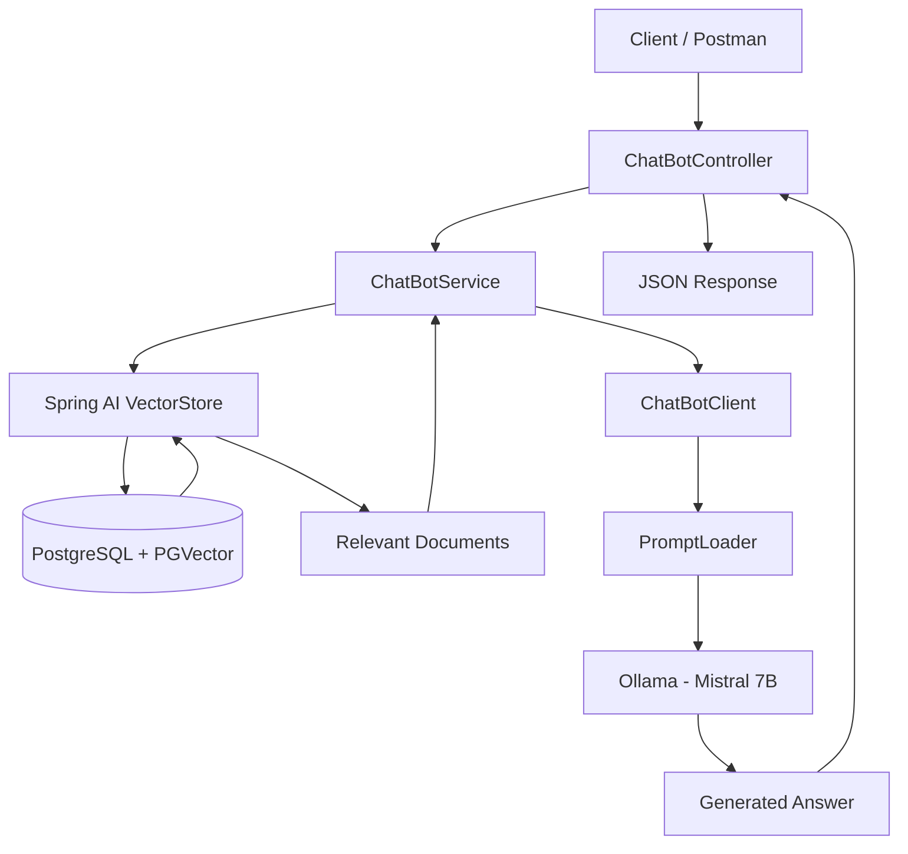

# Spring RAG Chatbot

A Retrieval-Augmented Generation (RAG) chatbot built with **Java 21, Spring Boot, Spring AI, Ollama, PostgreSQL, and PGVector**. The application retrieves semantically relevant documents from a vector database and uses a locally hosted large language model (LLM) to generate context-aware answers.

## Overview

Traditional chatbots rely primarily on the knowledge learned during model training. A RAG application supplements the LLM with relevant information retrieved from an external knowledge source at query time.

This project demonstrates a backend implementation of that workflow, including vector similarity search, prompt construction, local LLM integration, and REST API development.

### Key Features

* RESTful chatbot API built with Spring Boot.
* Local LLM integration using Ollama.
* Semantic document retrieval using Spring AI and PGVector.
* Vector embeddings generated with the `bge-m3:567m` model.
* Context-aware responses generated with `mistral:7b`.
* Configurable retrieval count and similarity threshold.
* PostgreSQL-backed vector storage.
* Document metadata support for source identification.
* Environment-variable-based database password configuration.

## Technology Stack

| Technology    | Purpose                              |
| ------------- | ------------------------------------ |
| Java 21       | Backend programming language         |
| Spring Boot   | Application framework                |
| Spring AI     | LLM and vector-store integration     |
| Ollama        | Local model runtime                  |
| Mistral 7B    | Chat and answer generation           |
| BGE-M3        | Text embedding generation            |
| PostgreSQL    | Database                             |
| PGVector      | Vector storage and similarity search |
| Maven         | Dependency management and build      |
| Postman       | Manual API testing                   |
| IntelliJ IDEA | Development environment              |

## Architecture



### Request Flow

1. The client sends a question and user ID to the REST API.
2. The controller validates the incoming request.
3. The service creates a vector similarity search request.
4. PGVector returns the most relevant documents.
5. The service combines the selected document text into a context.
6. The chatbot client builds the prompt and sends it to the local LLM.
7. The generated answer is returned to the client as JSON.

## Prerequisites

Install the following before running the application:

* JDK 21
* Git
* PostgreSQL
* PostgreSQL with the PGVector extension installed
* Ollama
* Maven Wrapper included in the project

### Required Ollama Models

Download the models used by the application:

```bash
ollama pull mistral:7b
ollama pull bge-m3:567m
```

Verify that the models are available:

```bash
ollama list
```

Ollama should be accessible at:

```text
http://localhost:11434
```

## Database Setup

Create the application schema and enable PGVector in your PostgreSQL database.

```sql
CREATE SCHEMA IF NOT EXISTS spring_rag;

CREATE EXTENSION IF NOT EXISTS vector;
```

Run these commands using a PostgreSQL account with the required privileges.

The application is configured to use the following vector-store table:

```text
Database: postgres
Schema:    spring_rag
Table:     vector_store
```

The vector column must support **1024 dimensions**, matching the configured embedding model.

> **Important:** The application uses `spring.ai.vectorstore.pgvector.initialize-schema=false`, so the vector-store table must be created and maintained separately. Use a compatible Spring AI PGVector schema when creating the table.

## Configuration

The application configuration is maintained in:

```text
src/main/resources/application.properties
```

Important settings include:

```properties
spring.application.name=spring-rag
server.port=8080
server.servlet.context-path=/v1

spring.ai.ollama.base-url=http://localhost:11434
spring.ai.ollama.chat.options.model=mistral:7b
spring.ai.ollama.embedding.model=bge-m3:567m

spring.datasource.url=jdbc:postgresql://localhost:5432/postgres?currentSchema=spring_rag
spring.datasource.username=postgres
spring.datasource.password=${DB_PASSWORD}

spring.ai.vectorstore.pgvector.schema-name=spring_rag
spring.ai.vectorstore.pgvector.table-name=vector_store
spring.ai.vectorstore.pgvector.dimensions=1024
spring.ai.vectorstore.pgvector.initialize-schema=false
```

The configuration above is representative of the current project setup. Retain any additional settings required by your implementation.

### Configure the Database Password

Never commit your actual database password to GitHub.

In PowerShell:

```powershell
$env:DB_PASSWORD="your_actual_postgres_password"
```

Set this environment variable in the same terminal or run configuration used to start the application.

## Run the Application

Clone the repository:

```bash
git clone <YOUR_GITHUB_REPOSITORY_URL>
cd spring-rag
```

Configure PostgreSQL, PGVector, Ollama, and the `DB_PASSWORD` environment variable.

Start the application using the Maven Wrapper.

**Windows:**

```powershell
.\mvnw.cmd spring-boot:run
```

**Linux/macOS:**

```bash
./mvnw spring-boot:run
```

By default, the API listens on port `8080` with the `/v1` context path.

## API Documentation

### Chat Endpoint

**Method:** `POST`

**URL:**

```text
http://localhost:8080/v1
```

The exact endpoint path depends on the `@RequestMapping` configured on your controller. Append that path to the base URL above.

**Content-Type:** `application/json`

### Request Body

```json
{
  "userId": "raj",
  "question": "What are the company's working hours?"
}
```

### Example Response

The current controller returns an answer and user ID in JSON:

```json
{
  "userId": "raj",
  "answer": "Working hours are from 9 AM to 6 PM, Monday to Friday."
}
```

The answer above is illustrative; the actual response depends on document retrieval and LLM generation. If source citations are enabled in your controller, the response can also include a `sources` field.

### Example Questions

Try questions related to the sample company-policy documents:

* What are the company's working hours?
* How many days of paid leave are available annually?
* What is the resignation notice period?
* What are the rules regarding company data confidentiality?
* Is remote work allowed?

The initial document loader inserts sample policy documents into the vector store when the application starts.

> **Development note:** The current loader truncates the configured vector-store table before loading the sample documents. Do not use this loader unchanged with production or user-owned data.

## Project Structure

The following is a representative structure; adjust package names to match the actual repository.

```text
spring-rag/
├── src/
│   ├── main/
│   │   ├── java/
│   │   │   └── com/springairag/spring_rag/
│   │   │       ├── controller/
│   │   │       ├── service/
│   │   │       ├── client/
│   │   │       ├── loader/
│   │   │       └── ...
│   │   └── resources/
│   │       ├── application.properties
│   │       └── templates/
│   │           └── systemPrompt.st
│   └── test/
├── .gitignore
├── mvnw
├── mvnw.cmd
├── pom.xml
└── README.md
```

## Current Limitations

* The initial document loader uses a fixed set of sample company-policy documents.
* The application requires a locally running Ollama instance and downloaded models.
* Retrieval quality depends on the embedding model, similarity threshold, and available documents.
* Source metadata is available for document identification; verify whether the current API exposes it in its response.
* Automated JUnit tests have not yet been implemented.
* The current sample-data initialization strategy is intended for development, not production.

## Future Enhancements

* Add automated unit and integration tests.
* Implement consistent global exception handling.
* Add document upload and ingestion APIs.
* Support chunking for longer documents.
* Return source citations and document metadata in API responses.
* Add authentication and authorization.
* Improve observability, structured logging, and request tracing.
* Add Docker-based deployment and a CI pipeline.
* Evaluate retrieval quality using a repeatable set of questions.

## Security Notes

* Keep database credentials and other secrets out of source control.
* Use environment variables or a secrets manager for sensitive configuration.
* Restrict access to the database and Ollama service appropriately.
* Do not expose internal exception messages or sensitive document content to clients.
* Review destructive database initialization behavior before deploying.

## License

Choose a license before distributing this project publicly. If you intend to make the code reusable by others, consider adding an appropriate open-source license file.
